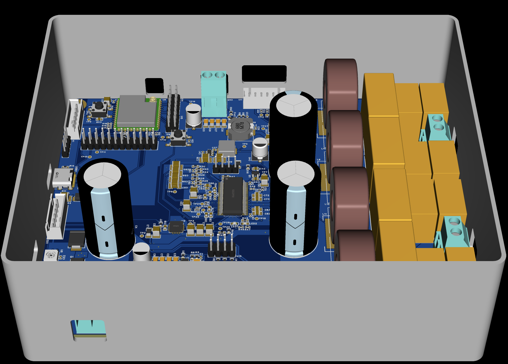

# NeatAmpTAS3251 — 2 × 170 W Class-D Amplifier with I²S Input, ESP32-S3 Control and DSP-Ready Design

> ⚠️ **Hobby project.** No deadlines, no warranties, no guarantees. Use at your own risk.

<p align="center">
  
</p>

A stereo Class-D power amplifier built around the **Texas Instruments TAS3251**
(digital-input, 2 × 175 W into 4 Ω). It takes I²S audio directly, so there is no
analog input stage to add noise. An **ESP32-S3** configures and supervises the
amplifier over I²C (volume, EQ, faults, power sequencing), and the board is
prepared for an **ADAU1466 DSP**. A single 35 V supply feeds the power stage. Low-noise
buck + LDO rails derived from it supply everything else, and USB-C powers the digital side for
programming.

This README describes **V1.3**, the current design (KiCad 10, layout in progress).
It also explains how to bring the V1.0/V1.1 prototype boards as close to V1.3 as
possible.

---

## Contents

- [At a glance](#at-a-glance)
- [Project status](#project-status)
- [Documentation map](#documentation-map)
- [What's new in V1.3](#whats-new-in-v13)
- [Upgrading V1.0/V1.1 boards towards V1.3](#upgrading-v10v11-boards-towards-v13)
- [Building a V1.3 board](#building-a-v13-board)
- [Hardware description](#hardware-description)
  - [Power supply](#power-supply)
  - [Protection](#protection)
  - [TAS3251 amplifier](#tas3251-amplifier)
  - [ESP32-S3 controller](#esp32-s3-controller)
  - [I²S audio input](#i2s-audio-input)
- [Production details (JLCPCB)](#production-details-jlcpcb)
- [Design files and tools](#design-files-and-tools)
- [Revision history](#revision-history)
- [Next versions: ideas](#next-versions-ideas)
- [Original project and license](#original-project-and-license)

---

## At a glance

| | |
|---|---|
| Amplifier | TI TAS3251, stereo BTL, **2 × 175 W into 4 Ω** at 35 V, digital (I²S) input, built-in DSP |
| PWM frequency | 600 kHz (set by R38, selectable 600 / 500 / 450 kHz) |
| Output filter | 10 µH + 1.05 µF film caps per leg (f₀ ≈ 49 kHz). Footprints for MA5172-AE (THT; 7 µH MA5173-AE is the same family) and Coilcraft XGL1712 (SMD) |
| Supply | One external **35 V** supply (Mean Well UHP-500-36, trimmed). USB-C 5 V for the digital side only |
| Controller | ESP32-S3-WROOM-1U-N8R8 (Wi-Fi, 8 MB flash, 8 MB Octal PSRAM), firmware in [`tas/`](tas/README.md) |
| DSP | ADAU1466 ready: I²S connector, supply and I²C prepared |
| Protection | 5 A slow-blow fuse, reverse-polarity P-FET, 36 V TVS, pop-free power sequencing with PVDD monitoring |
| Cooling | ATS heatsink designed for TI's TAS3251EVM, bonded to board GND |
| PCB | 161.55 × 124.43 mm, 4 layers, 2 oz outer copper, JLCPCB assembled (top side) |
| Design tool | KiCad 10 (V1.3). EasyEDA Pro for V1.0–V1.2 |

<p align="center">
  
</p>
<p align="center"><em>V1.2 PCB, top view (V1.3 renders will follow when the layout is finished)</em></p>

---

## Project status

| Version | Tool | State |
|---|---|---|
| V1.0 | EasyEDA Pro | 5 boards built (JLCPCB). Needs rework before use, see [Upgrading V1.0/V1.1](#upgrading-v10v11-boards-towards-v13) |
| V1.1 | EasyEDA Pro | USB-C orientation fix. Same rework as V1.0 otherwise |
| V1.2 | EasyEDA Pro | Layout done, DRC clean, **not produced**. Superseded by V1.3 |
| **V1.3** | **KiCad 10** | **Schematic done (ERC clean). PCB placement done, routing in progress.** Not yet produced |

**What's left before V1.3 can be ordered** is tracked in the review's
[open items summary](hw_review_2026-11-06.md#open-items):

- [pending actions](hw_review_2026-11-06.md#pending): routing, silkscreen, BOM, firmware, docs
- [parts to buy separately](hw_review_2026-11-06.md#purchase)
- [bottom-side parts](hw_review_2026-11-06.md#bottom-parts)
- [bench tests](hw_review_2026-11-06.md#hw-tests) for the first boards

⚠️ No revision has been validated in real operation yet. Treat the design as
experimental until the bench tests are done.

---

## Documentation map

| Document | What's in it |
|---|---|
| This README | Overview, V1.3 hardware description, building and upgrading boards |
| [hw_review_2026-11-06.md](hw_review_2026-11-06.md) | Full hardware review: every finding (P0 fixes, P1 savings, P2 improvements) with reasoning, datasheet references and status. Starts with the **open items summary** |
| [tas/README.md](tas/README.md) | ESP32-S3 firmware: ESP-IDF setup, build, debugging, firmware architecture, and the **step-by-step V1.0/V1.1 rework checklist** |
| [KiCADv10/README.md](KiCADv10/README.md) | How the KiCad 10 project was converted from EasyEDA, libraries and netlist checks |
| [Datasheets/](Datasheets/) | TAS3251, LMQ66430-Q1, TPS7A47, UHP-500, ADAU1462/1466, XU316-1024-QF60B (`C7397517.pdf`), heatsink datasheet and STEP |

---

## What's new in V1.3

V1.3 is the result of a full hardware review against the datasheets. The
most important changes are listed below. Each links to the detailed finding.

**Reliability and protection**

- **Reverse-polarity FET Q1 fixed.** It was mounted source-to-input on V1.0–V1.2, so it did not block a reversed supply. → [P0-6](hw_review_2026-11-06.md#p0-6)
- **F1 is now a slow-blow fuse** (0452005.MRL), sized for the 6600 µF PVDD inrush. → [P0-4](hw_review_2026-11-06.md#p0-4)
- **1 µF PVDD bypass caps right at the TAS3251 pins** (C108/C109, bottom side), as TI requires to keep output ringing below the 50 V maximum. → [V1.3-4](hw_review_2026-11-06.md#v13-4)
- **ESP32 EN pull-up** (R52 10 kΩ). EN used to float. → [P0-1](hw_review_2026-11-06.md#p0-1)
- **I²C moved off the ESP32 strapping pins** (SDA IO0 → IO47, SCL IO45 → IO21). A reset during an I²C transfer could leave the ESP32 in download mode. → [P0-2](hw_review_2026-11-06.md#p0-2)
- **C1 (feed-forward cap on the 13.2 V buck) removed.** At 10 nF it was ~50× over TI's limit. → [P0-5](hw_review_2026-11-06.md#p0-5)

**Pop-free switch-on and switch-off** → [P0-7](hw_review_2026-11-06.md#p0-7)
- RESET_AMP and ENABLE_12V are now **pulled down**: the power stage stays off until the firmware has configured it.
- **PVDD sense** divider on IO8 (R53/R54/C70): the firmware sees the supply collapse at mains-off and mutes before the power stage drops out.
- R55 10 kΩ in series with the TPS7A4701 EN pin protects it when 13.2 V is absent.

**Audio quality**

- DAC supply pins get 1 µF at the pin (C61/C67) instead of 100 nF. → [V1.3-4 #2](hw_review_2026-11-06.md#v13-4)
- DAC → SPK_IN network: 0.1 % thin-film resistors (R23–R30), C0G 1 nF, coupling caps C57–C60 moved next to the SPK_IN inputs, signal chain routed as differential pairs over a reworked AGND area. → [V1.3-4 #5](hw_review_2026-11-06.md#v13-4-f5), [P1-6](hw_review_2026-11-06.md#p1-6)
- Ferrite bead + 10 µF in front of the analog 3.3 V LDO (L15, C77). → [P2-1](hw_review_2026-11-06.md#p2-1)
- PWM frequency set by a single resistor (R38) close to the TAS3251 instead of a jumper header 35 mm away. → [V1.3-4 #6](hw_review_2026-11-06.md#v13-4-f6)

**Mechanical and PCB**

- **KiCad 10** project, 4-layer JLC04162H-7628 stack-up with **2 oz outer copper** and matching design rules. → [V1.3-3](hw_review_2026-11-06.md#v13-3)
- Board **6 mm wider**: the output stage moved to the new edge.
- **Proper heatsink** (ATS-TI1OP-1099-C1-R1, made for TI's TAS3251EVM), grounded through plated mounting holes. → [V1.3-1](hw_review_2026-11-06.md#v13-1)
- 3.3 V supply connector CN5: screw terminal → JST XH 2-pin. → [V1.3-2](hw_review_2026-11-06.md#v13-2)
- Test points reduced from 30 to 15, and all useful ones are reachable with the heatsink fitted. → [V1.3-5](hw_review_2026-11-06.md#v13-5)
- H2 expansion header reduced from 2×12 to 2×7.

**BOM**

- Cheaper Basic parts where the specification allows, fewer unique parts (67 → 61 LCSC part numbers). → [P1](hw_review_2026-11-06.md#p1)
- CLIP LED is now yellow (it was the same colour as FAULT).

---

## Upgrading V1.0/V1.1 boards towards V1.3

The five V1.0/V1.1 prototypes are used for firmware development and first
listening tests. Most V1.3 fixes can be retrofitted by hand. The step-by-step
instructions (with checks after each step) are in the
[V1.0/V1.1 rework checklist](tas/README.md#hardware-v10v11-rework-checklist-before-first-power-up)
in the firmware README. This table summarises what to do and how important it is.

### Must do before the first power-up

| # | V1.3 change | What to do on V1.0/V1.1 | Steps |
|---|---|---|---|
| 1 | IO35–IO37 are reserved for the Octal PSRAM (fixed in V1.2) | Remove C51, R17, R18. Bodge the status LEDs to IO8/IO9. Don't press SW2 (or move it to IO10) | [A1–A5](tas/README.md#a-rework-soldering-iron-board-unpowered) |
| 2 | EN pull-up R52 | 10 kΩ from TP9 (EN) to 3.3 V | [A6](tas/README.md#a-rework-soldering-iron-board-unpowered) |
| 3 | C1 DNP on the 13.2 V buck | Remove C1 (10 nF). TP2 must then read 13.2 V | [A7](tas/README.md#a-rework-soldering-iron-board-unpowered) |
| 4 | Shunts on U14/U15/H2/U13 | Fit all control shunts. U13: **exactly one** pair, 3-4 = 10 kΩ = 600 kHz | [B](tas/README.md#b-shunts--jumpers) |

### Must do before running at full PVDD and high power

| # | V1.3 change | What to do on V1.0/V1.1 | Steps |
|---|---|---|---|
| 5 | 1 µF PVDD bypass at pins 35/40 (C108/C109) | Solder a 1 µF 100 V X7R from the PVDD copper nearest each pin to GND, shortest loop. **Never on the pin row** | [A8](tas/README.md#a-rework-soldering-iron-board-unpowered), [review](hw_review_2026-11-06.md#v10-pvdd) |

Until then, run at reduced PVDD (20–24 V) and low volume only.

### Recommended (makes the board behave like V1.3)

| # | V1.3 change | What to do on V1.0/V1.1 | Steps |
|---|---|---|---|
| 6 | RESET_AMP / ENABLE_12V default off | 4.7 kΩ U15-8 → GND; remove R45 and add 10 kΩ U14-6 → GND | [P1](tas/README.md#optional-pop-free-rework-v13-equivalent) |
| 7 | PVDD sense | 100 kΩ / 6.8 kΩ / 100 nF divider from TP1 to U7 pin 3 (**IO4** instead of IO8) | [P2](tas/README.md#optional-pop-free-rework-v13-equivalent) |
| 8 | F1 slow-blow | Replace F1 with 0452005.MRL (same footprint) | [P3](tas/README.md#optional-pop-free-rework-v13-equivalent) |
| 9 | SW2 user button on IO10 | Cut the trace to IO35, wire SW2 to IO10, add a 10 kΩ pull-up | [SW2 on IO10](tas/README.md#optional-sw2-on-io10-v12-equivalent) |

Without 6–8 the board works, but clicks at switch-on and thumps at switch-off.
Mute before switching off the mains ([P4](tas/README.md#optional-pop-free-rework-v13-equivalent)),
and power up from a current-limited supply rather than hot-plugging a stiff 36 V one.

### Optional (audio refinements, same footprints)

These are not in the firmware README's checklist yet. They are simple part swaps on
existing pads:

| # | V1.3 change | What to do on V1.0/V1.1 |
|---|---|---|
| 10 | 1 µF at DAC_DVDD / DAC_AVDD pins (C67/C61) | Replace the 100 nF caps at U12 pins 9 and 56 with 1 µF X7R ≥ 25 V of the same size |
| 11 | Thin-film DAC network | Replace R23–R26 (499 Ω) and R27–R30 (100 kΩ) with 0.1 % thin-film parts of the same size |
| 12 | R55 10 kΩ in series with U2 EN | Low priority. Only matters if 3.3 V is present without 13.2 V (USB-C powering) |

### Not possible on V1.0/V1.1: work around instead

| V1.3 change | Workaround on V1.0/V1.1 |
|---|---|
| Q1 reverse-polarity FET orientation | **Check CN1 polarity with a meter before every connection** ([step 12a](tas/README.md#d-first-36-v-power-up)) |
| USB-C (V1.0 only, rotated) | Flash over UART ([section C](tas/README.md#c-flash-the-firmware-first-without-36-v)). No JTAG debugging on V1.0 |
| I²C off IO0/IO45 | Stays on IO0/IO45. Harmless on the N8R8 module. If a warm reset leaves the board in download mode, power-cycle it |
| Pin map (LEDs, DSP pins, ADR) | V1.0/V1.1 boards keep the V1.2 firmware pin map. V1.3 needs the new map ([open item A17](hw_review_2026-11-06.md#pending)) |
| Grounded heatsink, wider board, 2 oz design rules, AGND rework, L15 ferrite, R38 next to FREQ_ADJ | Layout changes, not retrofittable |

The remaining differences between a reworked board and V1.2/V1.3 are listed in
[Reworked V1.0/V1.1 vs V1.2](tas/README.md#reworked-v10v11-vs-v12).

---

## Building a V1.3 board

### 1. Order

- **PCB + top-side assembly at JLCPCB.** Settings in [Production details](#production-details-jlcpcb).
  On the BOM page, set the bottom-side parts to **Do Not Place** (list below).
- **Separate LCSC order** for the bottom-side parts: JLCPCB doesn't ship loose parts with a PCBA order.
- **Mouser** (or similar): output inductors and the heatsink.
- Hardware: 2 × metal M3 screws for the heatsink, thermal paste (not an insulating pad).

The full purchase list with quantities and alternatives is in the review:
[components to purchase separately](hw_review_2026-11-06.md#purchase).

### 2. Hand-fit the parts JLCPCB doesn't place

| Part(s) | What | Source |
|---|---|---|
| C108, C109, C80, C81, C20, C68 | Bottom-side capacitors, see [Bottom-side parts](#bottom-side-parts-hand-soldered) | LCSC |
| L7–L14 | Output inductors: **one per leg**, either MA5172-AE (THT) or XGL1712-103MED (SMD) | Mouser |
| Heatsink | ATS-TI1OP-1099-C1-R1 with 2 × metal M3 screws from the bottom and thermal paste | Mouser / Digi-Key |
| R39/R40, R56 | DNP by default. Fit only for multi-board sync or target mode | LCSC |

### 3. Bring up and test

Follow the bring-up order in the review's
[HW tests and measurements](hw_review_2026-11-06.md#hw-tests):

1. **Before power:** bottom parts fitted, heatsink grounded, CN1 polarity checked.
2. **Digital side first:** power from USB-C (or 5 V on H2 pin 1) and flash the firmware.
3. **First PVDD:** current-limited bench supply at 20–24 V. Check all rails on the [test points](#test-points).
4. **Full 35 V:** inrush, PSU start-up, pop/click and output overshoot measurements.
5. **Audio:** THD+N, frequency response, inductor comparison.

---

## Hardware description

### Power supply

The supply is a multi-rail design. The noisy, high-current steps use 2.2 MHz bucks,
and the sensitive rails get an LDO after the buck.

```text
                 ┌─ U1 LMQ66430 buck ─→ +13.2V ─ FB ─→ U2 TPS7A4701 LDO ─→ 12V_GVDD (TAS3251 gate drive)
35 V PSU ─ F1 ─ Q1 ─→ PVDD ─┤
   (CN1)        (D2 TVS)    ├─ U3 LMQ66430 buck ─→ 5 V ─ D5 ─┐
                 │          │                                ├─→ +5V ─┬─ U4 AP63203 buck ─→ 3.3V (digital)
                 │   USB-C VBUS ─────────────────── D3 ──────┘        └─ L15 ─ U5 TPS7A2033 LDO ─→ +3.3VA (DAC analog)
                 └─→ TAS3251 PVDD (power stage), 3 × 2200 µF bulk
```

| Rail | Voltage | Source | Feeds |
|---|---|---|---|
| PVDD | 35 V | External PSU via F1, Q1 | TAS3251 output stage, both bucks |
| +13.2V | 13.2 V | U1 LMQ66430 buck | U2 LDO input (GOOD_13.2V = U1 power-good) |
| 12V_GVDD | 12.0 V | U2 TPS7A4701 LDO | TAS3251 GVDD_A/B. Enabled by the ESP32 (ENABLE_12V) |
| +5V (**≈ 4.6 V**) | 4.4–4.8 V | U3 buck 5.02 V (via D5) or USB-C (via D3) | 3.3 V buck, analog LDO, status LEDs, I²S connector |
| 3.3V | 3.3 V | U4 AP63203 buck | ESP32-S3, TAS3251 DAC_DVDD, ADAU1466 digital |
| +3.3VA | 3.3 V | U5 TPS7A2033 LDO | TAS3251 DAC_AVDD only |

#### External PVDD supply: Mean Well UHP-500-36

The recommended supply is the **Mean Well UHP-500-36**
([datasheet](Datasheets/UHP-500-spec.pdf)).

| Parameter | UHP-500-36 | Relevance to this board |
|---|---|---|
| Output | 36 V / 13.9 A, 500 W | The TAS3251 at full power (2 × 175 W into 4 Ω) draws about 400 W. Music averages far less |
| Voltage trim | 34.2–37.8 V | **Trim to 35 V**: the LMQ66430 bucks are rated 36 V max recommended input |
| Over-voltage protection | 39.6–46.8 V | Trips below the TAS3251 PVDD absolute maximum of 50 V |
| Overload | 110–140 %, hiccup mode | Short peaks are fine; the 6600 µF bulk covers bass transients |
| Rise time | 50 ms | Charging 6600 µF in 50 ms takes about 4.75 A (≈ 1.1 A²s), well below F1's derated ~12 A²s |
| Ripple | 360 mVpp at 60–75 kHz | Above the audio band; handled by the bulk caps and the TAS3251's PSRR |
| Cooling | Fanless, through its case | Silent |

Installation notes:

1. **Trim the output to about 35 V** with the SVR potentiometer. At exactly 36 V (±1 %)
   the bucks would have no margin. 35 V costs about 0.25 dB of maximum output.
2. **Mount it flat on the metal chassis floor.** Mean Well specifies the full rating on
   a 450 × 450 × 3 mm aluminium plate. At normal listening levels this hardly matters.
3. **F1 limits continuous power, not the PSU.** 5 A at 35 V allows about 175 W continuous.
   That's fine for music, but a full-power sine test will blow it. Use a temporary
   higher-rated fuse for such tests, or fit a 7–8 A slow-blow if sustained full power is needed.
4. **DC-OK relay (optional).** Versions with the DC-OK connector open a contact when the
   output drops. Wired to a spare ESP32 GPIO, it would give an early mains-off warning in
   addition to the PVDD sense.
5. **Still to verify on the bench:** the PSU starts cleanly into ~6600 µF (no hiccup).
   See [T7](hw_review_2026-11-06.md#hw-tests).

#### Buck converters U1 / U3: LMQ66430MC3RXBRQ1

Both bucks use the same part ([datasheet](Datasheets/lmq66430-q1.pdf), LMQ664x0-Q1,
SNVSBV1F; top marking **3MC3Q**).

| Code | Meaning |
|---|---|
| Q | Internal VIN bypass caps (pins 4/5 floating) and internal BOOT cap (pin 8 open) |
| 3 | 3 A |
| M | MODE/SYNC on pin 13 (no RT pin) |
| C | **2.2 MHz fixed** switching frequency |
| 3 | 3.3 V fixed output, used here as **adjustable** (the FB divider is detected at start-up) |
| RXB, Q1 | VQFN-14 (2.6 × 2.6 mm), automotive grade |

- **FPWM:** MODE/SYNC (pin 13) is tied to 3.3 V, so both bucks run at a constant 2.2 MHz
  with spread spectrum and no PFM bursts in the audio band.
- **Minimum on-time:** U3 (35 V → 5 V) runs at its minimum on-time and stretches its
  period to about 1.8–2.0 MHz. It still regulates. U1 is not affected.
- **Feedback** (V_FB = 1.0 V). The divider must satisfy 5 kΩ < R_FBT ∥ R_FBB ≤ 10 kΩ
  so the start-up detection picks adjustable mode:

| Buck | Output | R_FBT | R_FBB | R_FBT ∥ R_FBB | C_FF | L |
|---|---|---|---|---|---|---|
| U1 | 13.2 V | R3 100 kΩ | R6 8.2 kΩ | 7.6 kΩ | C1 **DNP** (10 nF on V1.0–V1.2: remove) | L2 10 µH |
| U3 | 5.02 V | R8 49.9 kΩ | R9 12.4 kΩ | 9.9 kΩ | C23 DNP | L4 4.7 µH |

TI lists no feed-forward cap at 2.2 MHz. If U1's load-step response turns out poor, fit
47 pF C0G for C1 (limit ≈ 180 pF).

#### 12 V GVDD chain: U1 → TPS7A4701

A buck takes the large 35 V → 13.2 V step efficiently, and the TPS7A4701 (4 µVrms noise)
makes the final 13.2 V → 12.0 V. A ferrite bead (BLM31PG121SN1L) sits between them.
Output is set with ANY-OUT pins 5, 6, 9, 11 to GND: 1.4 + 6.4 + 3.2 + 0.8 + 0.2 = **12.0 V**.

The ESP32 enables the LDO (ENABLE_12V, IO38) only after it sees GOOD_13.2V (IO39).
R7 holds EN low by default, and R55 (10 kΩ in series) limits the current into EN if
3.3 V is present without 13.2 V.

> **Why two stages?** A linear regulator from 35 V to 12 V would dissipate over 1 W
> even at 50 mA in a small SMD package. Buck + LDO keeps losses low and the noise
> lower than a buck alone.

#### +5V rail (≈ 4.6 V) and USB-C power OR

U3 (5.02 V) and USB-C VBUS are OR-ed through SS34 Schottky diodes D5 and D3, so the
digital side runs from either. With USB-C only (programming), the TAS3251 power
stage stays unpowered. A 1 MΩ resistor discharges VBUS for clean hot-plugging.

The diode drop leaves the net called **+5V at about 4.6 V** (4.4–4.8 V from USB-C).
This is intentional: everything on it works at 4.6 V (AP63203 needs ≥ 3.8 V, TPS7A2033
≥ 3.45 V), and at 4.6 V the SK9822 LEDs still accept the ESP32's 3.3 V logic. Moving
U3's feedback after D5 was rejected because of start-up detection and stability risks
([P2-3](hw_review_2026-11-06.md#p2-3)).

**USB-C only** (programming): a PC port supplies 500 mA at 5 V, about 0.6 A at 3.3 V.
That powers the ESP32, but not the DSP board as well. Unplug the DSP board, or use a
USB-C charger that advertises ≥ 1.5 A.

#### 3.3 V rails

- **3.3V digital, U4 AP63203:** fixed 3.3 V, 2 A buck from +5V, always on (L5 6.8 µH,
  1.1 MHz). Feeds the ESP32-S3 and TAS3251 DAC_DVDD (~0.55 A peak). From the datasheets,
  the DSP board (ADAU1466 + XU316) adds ~0.6 A typical and ~1 A or more with a heavy DSP
  program. That leaves U4 with no margin. **The DSP board should therefore take its power
  from +5V** (U11 pin 2) and make its own 3.3 V, 1.8 V and 0.9 V (XU316) and 1.2 V
  (ADAU1466 core). Budget and details: [P2-10](hw_review_2026-11-06.md#p2-10).
- **+3.3VA analog, U5 TPS7A2033:** ultra-low-noise LDO (7 µVrms) for TAS3251 DAC_AVDD
  only. From V1.3 it is fed through **L15** (600 Ω ferrite bead) with **C77** 10 µF on the
  +5V side, so switching noise on +5V doesn't reach the DAC. Enabled by default (100 kΩ
  pull-up); the ESP32 can turn it off via ENABLE_3.3V (IO40).
- **CN5 (JST XH 2-pin)** brings 3.3 V out for external boards.

### Protection

| Part | Function | Notes |
|---|---|---|
| F1 | 0452005.MRL, 5 A **slow-blow** | Survives the bulk-cap inrush at every switch-on with ~4× margin. [P0-4](hw_review_2026-11-06.md#p0-4) |
| Q1 | E38P100KH P-FET, reverse polarity | V1.3: drain to input, source to PVDD (correct). Blocks a reversed supply. [P0-6](hw_review_2026-11-06.md#p0-6) |
| D2 | SMCJ36A TVS | Absorbs fast spikes. Stand-off 36 V, above the 35.35 V worst-case supply. [P0-5](hw_review_2026-11-06.md#p0-5) |
| Power sequencing | Pull-downs on RESET_AMP / ENABLE_12V, PVDD sense | Keeps the power stage off until configured and shuts it down cleanly at mains-off. [P0-7](hw_review_2026-11-06.md#p0-7) |

> Q1 is the only reverse-polarity guard. Check the **+ / −** marking at CN1 before connecting.

### TAS3251 amplifier

#### Signal chain

```text
I²S (U11) ─→ TAS3251 DAC ─ DAC_OUT± ─ 499 Ω ─┬─ 1 nF C0G (diff) ─┬─ 10 µF ─→ SPK_IN± ─→ power stage ─ 10 µH + film caps ─→ speaker
                                              └─ 100 kΩ to AGND ──┘
```

The TAS3251 contains the DAC and the power stage, connected externally through a
small passive network (TI Figure 8-1). In V1.3 this network uses:

- **0.1 % / 25 ppm thin-film resistors** (R23–R30) for better leg matching.
- **C0G 1 nF** differential caps (C56/C63). Keep them C0G: they carry the full DAC swing.
- **10 µF 50 V X7R coupling caps** (C57–C60), placed next to the SPK_IN pins to keep the loop short.
- The whole chain is routed as **differential pairs** (net class Audio_Diff) over the AGND area, symmetrical for + and −.

#### Supply decoupling

Per TI's datasheet (SLASEG6C), checked pin by pin in [V1.3-4](hw_review_2026-11-06.md#v13-4):
1 µF at DAC_DVDD/DAC_AVDD, 100 nF at GVDD, 33 nF bootstrap caps, 1 µF X7R 100 V
at each PVDD pin (bottom side, directly under the pins), 3 × 2200 µF bulk on PVDD.

#### PWM frequency: FREQ_ADJ resistor

The PWM switching frequency is set by a resistor from FREQ_ADJ (pin 18) to GND
(SLASEG6C §7.3.9). From V1.3 the jumper header U13 is gone. There are two 0603
positions directly behind pin 18:

- **R38**, FREQ_ADJ to GND, fitted with **10 kΩ = 600 kHz** (default, the highest).
- **R56**, FREQ_ADJ to 3.3 V, 0 Ω, DNP. Fit it (and remove R38) only for target/slave mode.

| R38 | Switching frequency | LCSC (1 %, 0603) |
|---|---|---|
| 10 kΩ | **600 kHz** (default) | C25804 |
| 20 kΩ | 500 kHz | C4184 |
| 30 kΩ | 450 kHz | C22984 |
| removed, R56 = 0 Ω | Target mode (external sync via H3) | C21189 |

Change it only with the board unpowered, or at least with RESET_AMP low.
OSC_IOM/OSC_IOP (pins 19/20) reach H3 through R39/R40 (22 Ω, **DNP**). Fit them only
when syncing several boards.

V1.0/V1.1 boards still have header U13: pairs 3-4 / 5-6 / 7-8 = 10 / 20 / 30 kΩ,
pair 1-2 = 3.3 V. Earlier versions of this README listed 768 / 576 / 384 kHz.
The datasheet gives 600 / 500 / 450 kHz.

#### Output filter

- **Inductors:** each leg has two alternative footprints. L7/L9/L11/L13 = Coilcraft
  XGL1712-103MED (SMD), L8/L10/L12/L14 = MA5172-AE (THT toroid, made for TI's class-D
  EVMs). **Fit only one per leg.** The plan is to keep MA5172-AE after a listening and
  distortion comparison ([P1-1](hw_review_2026-11-06.md#p1-1)).
- **Capacitors:** Jimson MKP (polypropylene) film caps. Never use PET/MKT here. **All are
  fitted:** 1 nF + 680 nF + 150 nF + 220 nF = **1.051 µF per leg** to GND.
- **Test plan:** first with **10 µH** (f₀ ≈ 49 kHz; −0.4 dB at 20 kHz into 4 Ω, +1 dB into 8 Ω),
  then possibly with the **7 µH MA5173-AE** (f₀ ≈ 59 kHz). The calculated response for each
  combination is in [P2-6](hw_review_2026-11-06.md#p2-6).

#### Grounding

GND is an unbroken plane on In1, with an **AGND** area under the DAC side and the
DAC → SPK_IN network, joined to GND only through R49 (0 Ω) next to U12. If the
bench shows hum or DAC noise, the first experiment is to merge AGND into GND
([V1.3-4 #4](hw_review_2026-11-06.md#v13-4-f4)).

#### Heatsink

**ATS-TI1OP-1099-C1-R1** (78 × 36 × 36.5 mm, ~1.6–2.2 °C/W with airflow), designed for
TI's TAS3251EVM. It is screwed on from the bottom with two **metal** M3 screws into
plated holes on GND, so the heatsink is bonded to board ground as TI requires. Use
thermal paste, not an insulating pad. Nothing taller than 2.5 mm sits under it, and
nothing under its feet ([V1.3-1](hw_review_2026-11-06.md#v13-1)).

#### Test points

V1.3 keeps 15 of the original 30 test points (bare 1 mm pads), all useful ones
reachable with the heatsink fitted.

| Priority | TP | Net | Reachable with heatsink |
|---|---|---|---|
| Must | TP1 | PVDD | yes |
| Must | TP2 | +13.2V | yes |
| Must | TP3 | 12V_GVDD (expect 12.0 V) | yes (moved next to U2 in V1.3) |
| Must | TP4 | +5V (expect ~4.6 V) | yes |
| Must | TP5 | 3.3V | yes |
| Must | TP6 | GND | yes |
| Must | TP8 | AGND | yes |
| Useful | TP13 | 5 V buck power-good (U3 PG) | yes |
| Useful | TP14–TP17 | I²S at U12 (MCLK, SCLK, SDIN, LRCK) | yes |
| Heatsink off | TP7 | +3.3VA | no |
| Heatsink off | TP21 | OC_ADJ | no |
| Heatsink off | TP23 | DVDD (U12 internal regulator) | no |

Removed in V1.3 (they still exist on V1.0–V1.2 boards). Probe here instead:

| Old TP | Net | Probe instead |
|---|---|---|
| TP9 | ESP32 EN | SW1 pin 2 pad |
| TP10 / TP11 | TXD / RXD | H2 pin 3 / pin 5 |
| TP12 | IO10 (SW2) | SW2 pin 1 pad |
| TP18 | 12V_GVDD | TP3 |
| TP19 | TAS_MUTE | U14 pin 2 |
| TP20 / TP22 / TP24 / TP26 | OUTA+ / OUTA− / OUTB+ / OUTB− | output inductor THT pads |
| TP25 | U12 AVDD | C80 pad on the bottom side |
| TP27 | 5 V buck output (before D5) | C31–C35 pads |
| TP28 / TP29 | TAS_FAULT / TAS_RESET | U14 pin 8 / pin 6 |
| TP30 | PVDDLMQ | C2–C7 pads |

### ESP32-S3 controller

The ESP32-S3-WROOM-1U-N8R8 (8 MB flash, 8 MB Octal PSRAM) configures the TAS3251,
sequences the power rails, monitors faults and PVDD, and drives the status LEDs.
Wi-Fi control (e.g. Home Assistant) is planned. Firmware setup, build and
architecture: [tas/README.md](tas/README.md).

#### Interface to the TAS3251 (V1.3)

All runtime control is over I²C (400 kHz). The bus is shared with the ADAU1466 when fitted.

| Signal | ESP32-S3 | TAS3251 pin | Default (pull resistor) |
|---|---|---|---|
| SDA | **IO47** | 54 | R21 6.8 kΩ pull-up |
| SCL | **IO21** | 53 | R22 6.8 kΩ pull-up |
| RESET_AMP | IO42 (via U14 5-6) | 27, active low | R45 10 kΩ **pull-down**: in reset until the firmware releases it |
| DAC_MUTE | IO1 (via U14 1-2) | 45, active low | R35 10 kΩ pull-down: muted |
| /FAULT | IO41 (via U14 7-8) | 28, open drain | 10 kΩ pull-up, falling-edge IRQ, red LED |
| /CLIP_OTW | IO2 (via U14 3-4) | 29, open drain | 10 kΩ pull-up, falling-edge IRQ, yellow LED |
| ADR | **IO13** (via H2 13-14) | 46 | 10 kΩ pull-down |
| ENABLE_12V | IO38 (via U15 7-8) | — (U2 EN) | R7 100 kΩ **pull-down**: GVDD off |
| GOOD_13.2V | IO39 (via U15 5-6) | — (U1 PG) | |
| ENABLE_3.3V | IO40 (via U15 3-4) | — (U5 EN) | 100 kΩ pull-up: analog 3.3 V on |
| PVDD_SENSE | **IO8** (ADC1_CH7) | — | R53 100 kΩ / R54 6.8 kΩ / C70 100 nF: 35 V → 2.23 V |

With a U14/U15 shunt removed, the corresponding line falls back to its default.
On V1.3 that means **the amplifier stays off**, which is the safe state.

**I²C address.** ADR low: 8-bit 0x90 (7-bit 0x48); ADR high: 0x92 (0x49). This is what
the firmware uses (`tas/main/tas3251.cpp`). The datasheet check in the review noted 0x4A
for ADR low. Confirm with an I²C scan at bring-up ([T13](hw_review_2026-11-06.md#hw-tests)).

#### What the ESP32-S3 controls via I²C

| Function | Register | Notes |
|---|---|---|
| Power on/off | B0-P0-R2 | Startup/shutdown sequence |
| Volume (per channel) | B0-P0-R61/R62 | 0.5 dB steps, −103 dB to +24 dB |
| Soft mute | B0-P0-R3 | Or via the DAC_MUTE pin |
| EQ / crossover biquads | Book 0x8C pages | 15 biquads per channel |
| Safeload (atomic update) | B0x8C-P5-R7C | Write 5 coefficients, then set the flag to 0x01 |
| Fault status | B0-P0-R94/R95 | OC, UV, OTE, clock error. Read after a /FAULT IRQ |
| Volume ramp speed | B0-P0-R64 | Used for pop-free mute and unmute |

#### Power-up and power-down sequence (V1.3)

```text
Mains on
  → PSU ramps PVDD → U1 (13.2 V) and U3 (5 V) start → U4 3.3 V → ESP32 boots
     (meanwhile: RESET_AMP low, ENABLE_12V low, DAC_MUTE low by hardware → silent)
  → ESP32 waits for GOOD_13.2V and PVDD ≥ 33 V (IO8)
  → ENABLE_12V high → 12V_GVDD up
  → wait 100–240 ms after DVDD before the first I²C access
  → I²S source running
  → RESET_AMP released → configuration written over I²C (volume, EQ, crossover)
  → DAC_MUTE high, volume ramps up → ready

Mains off (PVDD monitored every ≤ 1 ms)
  → PVDD < ~30 V: fast volume ramp down → DAC_MUTE low → RESET_AMP low → ENABLE_12V low
  → latched; restart only after PVDD > 33 V for ≥ 500 ms
```

The hardware for this is complete in V1.3. In the firmware, the switch-on part exists.
The PVDD threshold, the switch-off path and the new V1.3 pin map are still open
([A17–A19](hw_review_2026-11-06.md#pending)). The same shutdown path should also run on
/FAULT and before any software reset or OTA reboot.

#### Fault handling

Implemented in `tas::SystemController` (see the
[firmware README](tas/README.md#status-led-u8u9)):

1. /FAULT → interrupt → read B0-P0-R94/R95, re-assert DAC_MUTE, drop to a low volume. **Implemented.**
2. Over-temperature: wait for recovery, then toggle RESET_AMP. **Not implemented yet** (`TODO` in `SystemController::handleFault()`).
3. /CLIP_OTW (non-latching): logged only.
4. Fault reporting over Wi-Fi/MQTT: **not implemented yet.**

#### Indicators

| LED | Colour | Driven by |
|---|---|---|
| D_FAULT (LED1) | Red | /FAULT directly through 560 Ω. Works without firmware |
| D_CLIP (LED2) | Yellow (V1.3) | /CLIP_OTW directly through 560 Ω. Works without firmware |
| U8, U9 | SK9822 RGB, chained | ESP32: data IO46, clock IO3 on V1.3 (IO8/IO9 on V1.2 and reworked V1.0/V1.1). Colour scheme in the [firmware README](tas/README.md#status-led-u8u9) |

SW1 resets the ESP32. SW2 is a user button on IO10 (planned use: soft-off).

#### ESP32-S3 pin map

The V1.3 column comes from the KiCad 10 netlist. **Bold** marks a change from V1.2.
The detailed per-pin table is in the review ([pin map](hw_review_2026-11-06.md#pin-map)).

| GPIO | Module pin | V1.3 | V1.0/V1.1 (after rework) |
|---|---|---|---|
| IO0 | 27 | **H2-8 (BOOT: jumper to H2-7 GND)** | SDA |
| IO1 | 39 | DAC_MUTE (U14 1-2) | same |
| IO2 | 38 | /CLIP_OTW (U14 3-4) | same |
| IO3 | 15 | **SK9822 clock** (R17) | H2-4 |
| IO4–IO7 | 4–7 | U7 pins 3–6 (XH 6-pin) | same; IO4 = PVDD sense if P2 done |
| IO8 | 12 | **PVDD_SENSE** (ADC1_CH7) | SK9822 data (bodge) |
| IO9 | 17 | **H2-6** | SK9822 clock (bodge) |
| IO10 | 18 | SW2, R51 pull-up | H2-10 (or SW2 if reworked) |
| IO11 | 19 | H2-12 | H2-12 |
| IO12 | 20 | **H2-10** | ESP_TAS_ADR |
| IO13 | 21 | **ESP_TAS_ADR** (H2 13-14) | H2 (spare) |
| IO14 | 22 | **DSP_SELFBOOT** | H2 (spare) |
| IO15–IO18 | 8–11 | H1 pins 1–4 | same |
| IO19 / IO20 | 13 / 14 | USB D− / D+ | same |
| IO21 | 23 | **SCL** | H2 (spare) |
| IO35–IO37 | 28–30 | not connected (Octal PSRAM) | must be freed (rework A1–A5) |
| IO38 | 31 | ENABLE_12V (U15 7-8) | same |
| IO39 | 32 | GOOD_13.2V (U15 5-6) | same |
| IO40 | 33 | ENABLE_3.3V (U15 3-4) | same |
| IO41 | 34 | /FAULT (U14 7-8) | same |
| IO42 | 35 | RESET_AMP (U14 5-6) | same |
| IO43 / IO44 | 37 / 36 | TXD0 / RXD0 (H2-3 / H2-5) | same |
| IO45 | 26 | **H2-11** | SCL |
| IO46 | 16 | **SK9822 data** (R18) | H2-6 |
| IO47 | 24 | **SDA** | DSP_RESET |
| IO48 | 25 | **DSP_RESET** | DSP_SELFBOOT |
| EN | 3 | R52 10 kΩ pull-up, C48, SW1 | bodge 10 kΩ (rework A6) |

Firmware changes for V1.3: `SDA 0→47`, `SCL 45→21`, `DSP_RESET 47→48`,
`DSP_SELFBOOT 48→14`, `ESP_TAS_ADR 12→13`, `LED_CLK 9→3`, `LED_DATA 8→46`, new
`PVDD_SENSE = 8`. The single source of truth is [`tas/main/tas_pins.h`](tas/main/tas_pins.h),
currently still on the V1.2 map.

#### H2 expansion header (V1.3, 2×7)

| Pin | Signal | Pin | Signal |
|---|---|---|---|
| 1 | +5V | 2 | 3.3V |
| 3 | TXD0 | 4 | GND |
| 5 | RXD0 | 6 | IO9 |
| 7 | GND | 8 | IO0 (BOOT: jumper 7–8 while pressing SW1) |
| 9 | GND | 10 | IO12 |
| 11 | IO45 | 12 | IO11 |
| 13 | TAS_ADR | 14 | ESP_TAS_ADR (jumper 13–14) |

Strapping-pin rules: nothing on H2 may hold **IO0 low** at reset (download mode),
and nothing may pull **IO45 high** at power-up if a module without PSRAM is ever fitted.

#### ESP32-S3 software configuration

These must match the N8R8 module. They are seeded from
[`tas/sdkconfig.defaults`](tas/sdkconfig.defaults).

| Setting | Value | Reason |
|---|---|---|
| Flash size | 8 MB | N8 = 8 MB Quad flash |
| PSRAM | **Octal**, 80 MHz | R8 = 8 MB Octal PSRAM. Quad mode fails. This is why IO35–IO37 are reserved |
| Pin map | [`tas/main/tas_pins.h`](tas/main/tas_pins.h) | The build fails if a pin is set to IO35–IO37 |

<a id="i2s-audio-input"></a>

### I²S audio input

The I²S connector U11 (JST XH, 6-pin) accepts audio from:

- an **SPDIF → I²S receiver module** (e.g. LHY Audio DIR9001, 24-bit / 96 kHz)
- the **ADAU1466 DSP board** (future)

| Pin | Signal |
|---|---|
| 1 | GND |
| 2 | +5V (≈ 4.6 V) |
| 3 | MCLK |
| 4 | LRCK |
| 5 | SCLK (BCLK) |
| 6 | SDIN (DATA) |

Pinout from the V1.3 KiCad netlist. Earlier versions of this README listed a different
order (1 DATA … 5 +5V, 6 GND); check against your board before plugging in a module.

Series resistors on all four signal lines damp reflections and EMI. The ESP32 does not
drive I²S on the board. On V1.0/V1.1 a test tone can be patched from H2 to U11
([I2S test tone](tas/README.md#i2s-test-tone-h2-to-u11-patch)); the V1.3 H2 no longer
carries those pins.

---

## Production details (JLCPCB)

### PCB fabrication

| Parameter | V1.3 | V1.0/V1.1 (built) |
|---|---|---|
| Layers | 4 | 4 |
| Stack-up | **JLC04162H-7628**, ~1.66 mm | 1.6 mm |
| Copper (outer / inner) | 2 oz / 0.5 oz | 2 oz / 1 oz |
| Dimensions | **161.55 × 124.43 mm** | 155.45 × 134.33 mm |
| Base material | FR-4, TG155 | same |
| Colour / silkscreen | Blue / white | same |
| Surface finish | ENIG | same |
| Via covering | Plugged | same |
| Min track / spacing | 0.16 / 0.16 mm (2 oz rules) | — |
| Min via | 0.30 mm hole / 0.82 mm pad (default class) | 0.3 / 0.45 mm |
| Electrical test | Flying probe | same |
| Mark on PCB | Remove mark | same |
| Quality | IPC Class 2 | same |

> **Why these choices:** TG155 handles the output-stage heat better than TG135. ENIG
> gives flat pads for the fine-pitch parts (TAS3251 HSSOP-56 at 0.635 mm, LMQ66430
> VQFN-14, TPS7A4701 VQFN-20). 2 oz outer copper carries the PVDD and speaker
> currents. The V1.3 design rules follow JLCPCB's limits for 2 oz outer copper
> ([V1.3-3](hw_review_2026-11-06.md#v13-3)).

### SMT assembly

| Parameter | Value |
|---|---|
| PCBA type | Standard |
| Assembly side | **Top side only** |
| Quantity | 5 |
| Edge rails / fiducials | Added by JLCPCB |
| Confirm parts placement | Yes |
| Bake components | Yes |
| Photo confirmation | Yes |
| Board cleaning | Yes |
| Depanel and remove edge rails | Yes |
| Solder paste | High temperature |
| Nitrogen reflow, flying probe, function test, conformal coating | No |
| Packaging | Antistatic bubble film |

> **Recommended for first runs:** *Confirm Parts Placement* and *Photo Confirmation*
> let you verify the orientation of polarised parts before reflow. *Board Cleaning*
> removes flux residue that could cause leakage on the high-impedance analog nodes
> (DAC_AVDD, AGND area).

### Not assembled by JLCPCB

- **L7–L14:** output inductors, one per leg (order from Mouser)
- **Heatsink** and its M3 screws
- **Bottom-side capacitors** (below), order from LCSC
- **DNP options:** R39/R40 (sync), R56 (target mode)
- **Test points:** bare pads, no part

#### Bottom-side parts (hand-soldered)

JLCPCB assembles the **top side only**. Six capacitors sit on the bottom:

- **Four 1206s directly under their U12 pins** for the shortest possible loop.
  U12's DKQ package is top-cooled, so the bottom under it is free.
- **Two 1210 bulk caps** (C20, C68) that moved to the bottom to make room for
  C57–C60 next to the SPK_IN inputs.

| Ref | Function | U12 pin | Part | LCSC | Qty / board |
|---|---|---|---|---|---|
| C108 | PVDD_A bypass (**mandatory**) | 40 | Samsung CL31B105KCHNNNE, 1 µF 100 V X7R 1206 | C13832 | 1 |
| C109 | PVDD_B bypass (**mandatory**) | 35 | Samsung CL31B105KCHNNNE, 1 µF 100 V X7R 1206 | C13832 | 1 |
| C80 | AVDD decoupling | 23 | Samsung CL31B105KCHNNNE, 1 µF 100 V X7R 1206 | C13832 | 1 |
| C81 | C_START (pop-free ramp) | 24 | Yageo CC1206JRX7R9BB223, 22 nF 50 V X7R 1206 | C527321 | 1 |
| C20 | 12V_GVDD bulk | — | Samsung CL32B106KBJNNNE, 10 µF 50 V X7R 1210 | C138687 | 1 |
| C68 | 3.3 V (DAC_DVDD) bulk | — | Samsung CL32B106KBJNNNE, 10 µF 50 V X7R 1210 | C138687 | 1 |

Per 5 boards: **15 × C13832**, **5 × C527321** and **10 × C138687** (order a few spares).

- **C108/C109 are mandatory.** Without them, output ringing at high PVDD can exceed
  the pin ratings and damage the TAS3251. The In2 PVDD plane doesn't replace them.
- **C_START = 22 nF** gives a slower start-up ramp. TI recommends 10 nF for best
  pop/click; the value will be decided after the pop test ([A15](hw_review_2026-11-06.md#pending)).
- R38/R56 (FREQ_ADJ) are planned to move to the bottom as well
  ([A4](hw_review_2026-11-06.md#pending)). R38 then joins this list.

**Ordering checklist:**

1. JLCPCB doesn't ship loose parts with a PCBA order. Buy the bottom parts from **LCSC**
   as a separate order.
2. The bottom footprints (and DNP R56) are set to **Exclude from position files**, so the
   CPL contains top-side parts only.
3. They stay in the KiCad BOM. On JLCPCB's BOM page set
   **C20, C68, C80, C81, C108, C109 → Do Not Place**, so they are neither quoted nor
   assembled and no double-sided assembly is charged.
4. Solder them after the boards arrive, **before the first power-up**.

---

## Design files and tools

### KiCad 10 (V1.3)

The V1.3 design lives in [`KiCADv10/`](KiCADv10/) (branch `hw/pcb-layout`):
schematic (5 sheets), PCB, custom rules (`NeatAmp.kicad_dru`) and libraries.

- `libs/easyeda2kicad.*`: LCSC parts fetched with `get_lcsc_libs.sh`.
- `NeatAmp_custom`: hand-made footprints (output inductors, TAS3251 + heatsink).
- ⚠️ The USB-C footprint (C165948) is hand-edited. **Don't re-run `get_lcsc_libs.sh`
  for C165948**: `--overwrite` would undo the fixes.
- A V1.3 schematic PDF will be exported once the layout is finished.

Details: [KiCADv10/README.md](KiCADv10/README.md).

### EasyEDA Pro (V1.0–V1.2)

The earlier revisions are in [`EasyEDA-Pro/`](EasyEDA-Pro/) (made with EasyEDA Pro
V3.2.149, V1.2 with V3.2.209). To use the custom component library, link it into
your EasyEDA Pro libraries directory and restart EasyEDA Pro:

```bash
# macOS / Linux
cd ~/Documents/EasyEDA-Pro/libraries
ln -s /path/to/NeatAmpTAS3251/EasyEDA-Pro/libraries/* .
```

```cmd
:: Windows (Command Prompt as Administrator)
cd %USERPROFILE%\EasyEDA-Pro\libraries
mklink /D NeatAmpTAS3251-lib C:\path\to\NeatAmpTAS3251\EasyEDA-Pro\libraries
```

The library appears under `NeatAmpTAS3251-lib` in the **Libraries** panel.

---

## Revision history

### V1.3 (KiCad 10, in progress)
See [What's new in V1.3](#whats-new-in-v13) and the
[hardware review](hw_review_2026-11-06.md).

### V1.2 (EasyEDA Pro, not produced)

- **ESP32-S3 module pins 28/29/30 (IO35/IO36/IO37) no longer used.** On the N8R8 these
  belong to the internal Octal PSRAM. V1.0/V1.1 used them for SW2/C51 and the status LEDs,
  which corrupts PSRAM and crashes the firmware. LEDs moved to IO8/IO9, SW2 to IO10
  with a new R51 pull-up.
- PCB re-routed, DRC clean. Outline, connectors and heatsink area unchanged.

### V1.1

- ESP32 USB-C connector was rotated 180° on V1.0. Fixed.
- JLCPCB production settings documented.

### V1.0

- First prototype, routed in EasyEDA Pro. 5 boards built by JLCPCB.

### Known issues from the original design

- Silkscreen polarity of C25–C28 was inverted. Resolved by using non-polarised X7R ceramics.
- Heatsink footprint needed rework. Resolved in V1.3 with the ATS heatsink.

---

## Next versions: ideas

- Ideal-diode OR instead of D3/D5: removes ~0.7 W of diode loss at full digital load and gives a true 5.0 V (then the SK9822 lines need a 5 V buffer) ([P2-3](hw_review_2026-11-06.md#p2-3), [P2-10](hw_review_2026-11-06.md#p2-10)).
- A real BOOT button on IO0 instead of the H2 jumper ([P2-4](hw_review_2026-11-06.md#p2-4)).
- Wire the PSU's DC-OK contact to a GPIO as an early mains-off warning.
- Enclosure: the supplied 3D shell has **not passed JLCPCB's manufacturing review** and
  needs a redesign before production. It is included for reference only.

---

## Original project and license

- Based on [jmf13/NeatAmpTAS3251](https://github.com/jmf13/NeatAmpTAS3251/tree/master).
  This project extends it with the ESP32-S3 controller, a redesigned power supply,
  DSP preparation and the inductor comparison.
- License: [CC BY-SA 4.0](https://creativecommons.org/licenses/by-sa/4.0/), inherited from the original.
