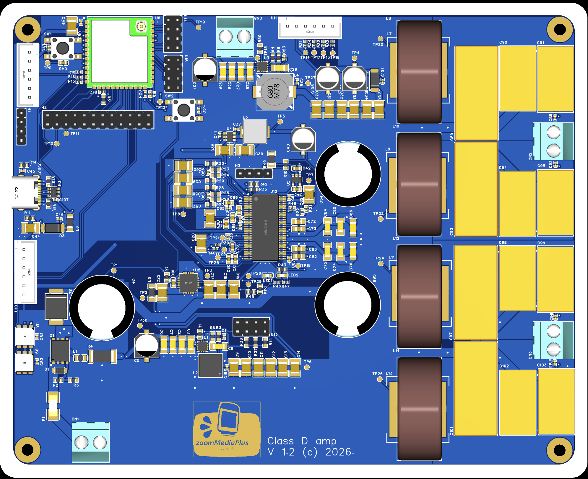

# NeatAmpTAS3251 — 2×170W Class D Amplifier with I2S Input & DSP

> ⚠️ **Hobby project** — no deadlines, no warranties, no guarantees. Use at your own risk.

<p align="center">

  

</p>

2×170 W Class-D amplifier based on the Texas Instruments TAS3251, featuring an ESP32-S3 controller, DSP-ready architecture, USB-C programming, and a low-noise multi-rail power supply.

---

## Overview

This project builds on the excellent [NeatAmpTAS3251](https://github.com/jmf13/NeatAmpTAS3251/tree/master)
design by jmf13 and extends it with:

- **ESP32-S3** — WiFi control, I2C management of TAS3251 (volume, EQ, fault monitoring)
- **Output inductors** — dual footprint for Coilcraft XGL1712-103MED and Würth 7443631000
  for comparative distortion testing
- **ADAU1466 DSP ready** — I2S input connector, power supply, and I2C interface prepared
  for future DSP integration
- **Revised power supply** — fully redesigned for lower noise and better thermal performance
- **EasyEDA Pro** — migrated from KiCad v9 for simplified JLCPCB prototyping workflow

The complete V1.2 hardware schematic is available in [Schematic.pdf](Schematic.pdf).

<p align="center">

  

</p>

<p align="center"><em>V1.2 PCB, top view</em></p>

---

## Release Notes

### Version 1.2 (schematic + PCB layout done, DRC clean, not yet produced)
- **Important fix — ESP32-S3 module pins 28/29/30 (IO35/IO36/IO37) no longer
  used.** On the ESP32-S3-WROOM-1U-N8R8 these pins are wired internally to the
  Octal PSRAM and must stay unconnected. V1.0/V1.1 used them for SW2 + C51
  (IO35) and for the SK9822 status LED data/clock (IO36/IO37 via R18/R17).
  Using them corrupts PSRAM and crashes the firmware. Changes (netlist
  [Netlist_Class_D_amp_2026-10-30.enet](Netlist_Class_D_amp_2026-10-30.enet)):
  - Module pins 28, 29, 30 → **no connection**.
  - Status LED U8 SDI → R18 (27 Ω) → **IO8** (module pin 12).
  - Status LED U8 CKI → R17 (27 Ω) → **IO9** (module pin 17).
  - SW2 + C51 (100 nF debounce) + TP12 → **IO10** (module pin 18), with a
    new **R51 10 kΩ** pull-up to 3.3V.
  - IO8, IO9 and IO10 are **no longer on H2**. H2 pins 7, 8 and 10 are now
    not connected.
- Firmware already follows this mapping: LEDs on IO8/IO9, PSRAM in Octal mode
  (see [ESP32-S3 module pinout](#esp32-s3-module-pinout) and the
  [firmware README](tas/README.md#reserved-pins-do-not-use)).
- PCB re-routed for the new connections. DRC passes. Board outline,
  connector positions and the heatsink area are unchanged from V1.0/V1.1.
- Silkscreen revision text updated to **V 1.2**.
- [Schematic.pdf](Schematic.pdf), the 3D render and the new top-view render
  ([Pictures/PCB_3D_TOP.png](Pictures/PCB_3D_TOP.png)) are re-exported from
  V1.2.
- V1.0/V1.1 boards can be reworked to the same firmware mapping. See the
  [V1.0/V1.1 rework checklist](tas/README.md#hardware-v10v11-rework-checklist-before-first-power-up),
  including the list of differences that remain after rework.

### Version 1.1
- **Important fix** — ESP32 USB-C connector was rotated 180° in V1.0, making the
  connector unusable when assembled. Now fixed.
- Added complete JLCPCB production specifications (see
  [Production Details](#production-details-jlcpcb)) as used for the first
  prototype batch.

### Version 1.0
- PCB routing completed for the first prototype revision.
- EasyEDA Pro project migrated to the new `.eprj2` project format.
- Development performed using **EasyEDA Pro V3.2.149** (V1.2 changes made
  with **V3.2.209**).
- Latest layout improvements include routing optimisation, power distribution refinement, grounding improvements, and thermal optimisation.

---

## Status

**Version:** 1.0/1.1 (Prototype), 1.2 (layout done, not yet produced)

⚠️ **V1.0/V1.1 boards need rework before the first power-up**:
- remove C51, R17 and R18, and bodge the LEDs to IO8/IO9
- add a 10 kΩ pull-up from ESP32 EN (TP9) to 3.3V

V1.0 also needs UART flashing because of the rotated USB-C connector.

Optional for boards used in firmware development: the
[pop-free rework](tas/README.md#optional-pop-free-rework-v13-equivalent).
It changes RESET_AMP and ENABLE_12V to default off and adds a PVDD sense
divider on IO4. It can also swap F1 for a time-lag fuse. These are the V1.3
fixes from review P0-7 / P0-4. Without it the board works, but clicks at
switch-on and thumps at switch-off, so mute before switching the mains off.

On V1.0/V1.1 the reverse-polarity FET Q1 is mounted the wrong way round, so
**check the CN1 polarity before connecting** and use a current-limited
supply for the first power-up. Follow the
[V1.0/V1.1 rework checklist](tas/README.md#hardware-v10v11-rework-checklist-before-first-power-up).

⚠️ This is the first public prototype release. The hardware has **not yet been validated in real-world operation**. It should be considered experimental until prototype testing is completed.


---

## Power Supply Architecture

The power supply is a multi-rail design optimised for low noise on sensitive analog paths
while keeping thermal dissipation manageable across all operating conditions.

### Rail Overview

| Rail | Voltage | Chip | Purpose |
|------|---------|------|---------|
| PVDD | 36V | External PSU | TAS3251 output stage (H-bridges) |
| 13.2V | Buck | LMQ66430 (U1) | Intermediate rail for GVDD chain |
| 12V GVDD | LDO | TPS7A4701 | TAS3251 gate drive (GVDD_A, GVDD_B, VDD) |
| 5V | Buck | LMQ66430 (U3) | System 5V bus, USB-C OR node |
| 3.3V digital | Buck | AP63203 | ESP32-S3, STM32, ADAU1466, TAS DAC_DVDD |
| 3.3V analog | LDO | TPS7A2033 | TAS3251 DAC_AVDD only |

### External PVDD Supply — Mean Well UHP-500-36

The recommended PVDD supply is the **Mean Well UHP-500-36**
(datasheet: [Datasheets/UHP-500-spec.pdf](Datasheets/UHP-500-spec.pdf)).

| Parameter | UHP-500-36 | Relevance to this board |
|-----------|------------|-------------------------|
| Output | 36 V / 13.9 A, 500 W | TAS3251 at full power (2 × 175 W into 4 Ω) draws about 400 W. Music averages far less. |
| Voltage trim | 34.2–37.8 V | TAS3251 PVDD: recommended max 38 V, absolute max 50 V |
| Over-voltage protection | 39.6–46.8 V | Trips below the TAS3251 absolute max of 50 V |
| Overload | 110–140 %, hiccup mode | Short peaks are fine, and the 3 × 2200 µF PVDD bulk caps cover bass transients |
| Start-up / rise time | 1000 ms / 50 ms | Charging 6600 µF to 36 V in 50 ms takes about 4.75 A (≈ 1.1 A²s). That's well below the ~12 A²s derated limit of F1 (0452005.MRL slow-blow) |
| Ripple and noise | 360 mVpp, PFC 60 kHz / PWM 65–75 kHz | Above the audio band; the bulk caps and the TAS3251's 60 dB PSRR handle it |
| Cooling | Fanless, cooled through its case | Silent |
| Other | Active PFC, 94 % efficiency, EMC Class B, optional DC-OK relay | |

Installation notes:

1. **Trim the output to about 35 V** with the SVR potentiometer. The
   LMQ66430 bucks (U1, U3) are 36 V-input parts, so running exactly at
   36 V (±1 %) leaves them no margin. 35 V costs about 0.25 dB of maximum
   output.
2. **Mount it flat on the metal chassis floor**, with thermal grease if the
   surface isn't smooth. Mean Well specifies the full rating on a
   450 × 450 × 3 mm aluminium plate (or a cabinet of the same size). Without
   one it is derated. At normal listening levels this hardly matters.
3. **F1 limits continuous power, not the PSU.** A 5 A fuse at 36 V allows
   about 180 W continuous. That's fine for music, but a full-power sine test
   will blow it. Use a bench supply or a temporary higher-rated fuse for such
   tests, or fit a 7–8 A slow-blow if sustained full power is needed.
4. **DC-OK relay (optional).** Versions with the DC-OK connector (CN1, JST
   PH 2-pin, 30 V / 1 A contact) open the contact when the output drops.
   Wired to an ESP32 GPIO with a pull-up, it would let the firmware mute and
   reset the amp before PVDD collapses at mains switch-off, which removes the
   switch-off thump. Check that the version you order has the connector.
5. **Still to verify on the bench:** the datasheet gives no maximum
   capacitive load. Confirm with a scope at mains switch-on that the PSU
   starts cleanly into about 6600 µF plus the buck input caps (see
   [hw_review_2026-11-06.md](hw_review_2026-11-06.md), P0-4).

### Buck Converters U1 / U3 — LMQ66430MC3RXBRQ1

Both bucks use the same part (datasheet: [Datasheets/lmq66430-q1.pdf](Datasheets/lmq66430-q1.pdf),
LMQ664x0-Q1, SNVSBV1F rev F; top marking **3MC3Q**).
Decoding the part number with the datasheet's nomenclature (Figure 9-1):

| Code | Meaning |
|------|---------|
| Q | Internal VIN bypass caps (pins 4/5 = cap midpoint, left floating) and internal 100 nF BOOT cap (pin 8 left open) |
| 3 | 3 A |
| M | MODE/SYNC on pin 13 (this variant has no RT pin) |
| C | **2.2 MHz fixed** switching frequency |
| 3 | 3.3 V fixed output. Used here as **adjustable**: the FB divider is detected at start-up |
| RXB, Q1 | VQFN-14 (2.6 × 2.6 mm), automotive grade |

- **Clocking:** a fixed 2.2 MHz (with dual random spread spectrum), so there is
  no RT resistor. MODE/SYNC (pin 13) is tied to the 3.3V rail to select
  **FPWM**: constant frequency at light load, no PFM bursts in the audio band.
  Per the datasheet (Table 7-1), MODE/SYNC above V_MODE_H (1.6 V max) selects
  FPWM, below V_MODE_L (1.0 V) selects auto/PFM, and a clock syncs. 3.3 V is
  well above the threshold and below the pin's 5.5 V absolute maximum. Bench
  check: the SW node should be a continuous ~2.2 MHz square wave at idle.
- **Minimum on-time:** at 35 V in, U3 (→ 5 V) needs about 65 ns per cycle,
  which is at the device's minimum on-time. It then stretches its period to
  about 1.8–2.0 MHz and keeps regulating. U1 (→ 13.2 V) is not affected.
- **Feedback** (V_FB = 1.0 V, V_OUT = 1 V × (1 + R_FBT / R_FBB)). The divider
  must satisfy 5 kΩ < R_FBT ∥ R_FBB ≤ 10 kΩ so the start-up detection picks
  adjustable mode:

| Buck | Output | R_FBT | R_FBB | R_FBT ∥ R_FBB | C_FF | L |
|------|--------|-------|-------|---------------|------|---|
| U1 | 13.2 V | R3 100 kΩ | R6 8.2 kΩ | 7.6 kΩ | C1: **DNP** (10 nF on V1.0–V1.2, remove) | L2 10 µH |
| U3 | 5.02 V | R8 49.9 kΩ | R9 12.4 kΩ | 9.9 kΩ | C23: 10 pF C0G | L4 4.7 µH |

TI's Table 8-1 lists no feed-forward cap at 2.2 MHz. The upper limit is
C_FF < C_OUT × √V_OUT / 1.2 MΩ, which is about 180 pF for U1 and 110 pF for U3.

### 12V GVDD Chain — LMQ66430 (U1) → TPS7A4701

The gate drive supply uses a two-stage approach: a switching regulator handles the large
36V→13.2V step efficiently, followed by a low-noise LDO for the final 13.2V→12V drop. ESP32 senses GOOD_13.2V on IO39 and once stable, it triggers 12V analog power via IO38.

```
PVDD (35V) → LMQ66430 U1 (buck, 2.2MHz FPWM) → 13.2V → TPS7A4701 (LDO) → 12V GVDD
```

- **LMQ66430 (U1)**: 2.2 MHz fixed, feedback R3 = 100 kΩ / R6 = 8.2 kΩ → 13.2 V
  (see the buck section above)
- **TPS7A4701**: 1A LDO, 4µVrms noise, 82dB PSRR @ 100Hz, output set via ANY-OUT
  pin programming to 12.0V (pins 0P2V + 0P8V + 3P2V + 6P4V1 → GND)
- A ferrite bead (BLM31PG121SN1L) is placed between the 13.2V rail and TPS7A4701
  input for additional HF noise isolation

> **Why two stages?** A direct linear regulator from 36V to 12V at even 50mA load
> would dissipate ~1.2W in a small SMD package. The buck + LDO combination keeps
> total dissipation under 0.8W while achieving better noise performance than a
> single-stage buck alone.

### 5V Rail — LMQ66430 (U3)

```
PVDD (35V) → LMQ66430 U3 (buck, 2.2MHz FPWM) → 5V
```

- Feedback: R8 = 49.9 kΩ / R9 = 12.4 kΩ → 5.02 V (TI's recommended values for 5 V), C23 = 10 pF
- Feeds the 5V OR node (see USB-C section)
- Sources the 3.3V digital buck and 3.3V analog LDO

### 3.3V Digital Rail — AP63203

```
5V OR rail → AP63203 (fixed 3.3V buck) → 3.3V digital
```

- Fixed 3.3V output — no external feedback resistors
- Powers: ESP32-S3, STM32F030, ADAU1466 digital, TAS3251 DAC_DVDD
- Starts automatically on power-up (EN tied to VIN)
- Output: 2× 10µF ceramic + 1× 47µF electrolytic

### 3.3V Analog Rail — TPS7A2033

```
5V OR rail → TPS7A2033 (LDO) → 3.3VA
```

- Ultra-low noise LDO: 7µVrms, 95dB PSRR
- Feeds **only** TAS3251 DAC_AVDD — kept isolated from noisy digital loads
- Enabled by default via 100kΩ pull-up to 3.3V digital; ESP32-S3 can disable via
  ENABLE_3.3V GPIO IO40 for controlled power sequencing
- Input/output decoupling: 1µF Samsung CL10B105KB8NQNC (C5199872) on both pins

### USB-C Power OR

The board supports powering the digital section from either the main 36V supply
or a USB-C connection, enabling ESP32-S3 programming without the main supply present.

```
PVDD (36V) → LMQ66430 → 5V → Schottky D1 ─┐
                                             ├─ 5V OR rail → AP63203 → 3.3V digital
USB-C VBUS (5V) ────────→ 1N5819 D2 ────────┘
```

- When 36V is present: LMQ66430 supplies the 5V OR rail; USB-C Schottky is
  reverse-biased
- When USB-C only (programming mode): USB VBUS supplies 3.3V digital via AP63203;
  TAS3251 analog section remains unpowered
- 1MΩ discharge resistor on VBUS for clean hot-plug behaviour

---

## Microcontroller — ESP32-S3 controlling TAS3251

The ESP32-S3-WROOM-1U-N8R8 (8 MB flash, 8 MB Octal PSRAM) acts as the system controller, handling WiFi connectivity,
TAS3251 configuration, real-time monitoring, and user interface.

For the ESP32-S3 firmware workspace, including the Python environment, ESP-IDF
6.0.2 setup, build commands, and editor configuration, see the
[ESP32-S3 firmware README](tas/README.md) before continuing with the hardware
interface details below.

### Interface to TAS3251

All TAS3251 runtime control is via I2C (400kHz Fast Mode). The I2C bus is shared
with the ADAU1466 when fitted.

| Signal | ESP32-S3 GPIO | TAS3251 Pin | Notes |
|--------|--------------|-------------|-------|
| SDA | GPIO IO0 | SDA (54) | 6.8kΩ pull-up (R21) to 3.3V |
| SCL | GPIO IO45 | SCL (53) | 6.8kΩ pull-up (R22) to 3.3V |
| RESET_AMP | GPIO out IO42 | /RESET_AMP (27) | Active low; R45 10kΩ. V1.0–V1.2: pull-up to 3.3V (default: not in reset). V1.3: pull-down to GND (default: in reset) |
| DAC_MUTE | GPIO out IO1 | DAC_MUTE (45) | Active low; 10kΩ pull-down to GND (default: muted at boot) |
| /FAULT | GPIO in + IRQ IO41 | /FAULT (28) | Open-drain; 10kΩ pull-up; falling-edge interrupt |
| /CLIP_OTW | GPIO in + IRQ IO2 | /CLIP_OTW (29) | Open-drain; 10kΩ pull-up; falling-edge interrupt |

### TAS3251 I2C Address

Set by ADR pin (46):
- ADR → GND: address **0x90**
- ADR → 3.3V: address **0x92**

This pin is connected to ESP32 IO12.

### Switching Frequency Select — U13

The TAS3251 PWM switching frequency is set by a resistor from FREQ_ADJ (pin 18)
to AGND, broken out on jumper header **U13** (2x4, 2.54mm). Bridge exactly one
pin pair with a shunt; the current default is **pins 3-4 (10kΩ)**, giving the
highest switching frequency.

| U13 pins | R to AGND | Switching frequency |
|----------|-----------|----------------------|
| 3-4 | 10kΩ only | 768kHz ← highest (default) |
| 5-6 | 20kΩ only | 576kHz |
| 7-8 | 30kΩ only | 384kHz |
| 1-2 | Pulled to 3.3V | Target/slave mode (external sync via OSC_IOP/IOM) |

### What ESP32-S3 Controls via I2C

| Function | Register | Notes |
|----------|----------|-------|
| Power on/off | B0-P0-R2 | Startup/shutdown sequence |
| Volume (per channel) | B0-P0-R61/R62 | 0.5dB steps, −103dB to +24dB |
| Soft mute | B0-P0-R3 | Or via DAC_MUTE pin |
| EQ / crossover biquads | Book 0x8C pages | 15× BiQuad per channel; crossover HPF/LPF |
| Safeload (atomic update) | B0x8C-P5-R7C | Write 5 coefficients then set flag = 0x01 |
| Fault status read | B0-P0-R94/R95 | OC, UV, OTE, clock error — read after /FAULT IRQ |
| Volume ramp speed | B0-P0-R64 | Controls startup/shutdown ramp to prevent pops |

### Fault Handling

Both /FAULT and /CLIP_OTW are open-drain active-low outputs wired to ESP32-S3
interrupt-capable GPIOs. Implemented in `tas::SystemController` — see the
[ESP32-S3 firmware README](tas/README.md#status-led-u8u9) for the full
state/color breakdown:

1. /FAULT asserts → falling-edge ISR fires → read B0-P0-R94/R95 for fault
   detail, re-assert DAC_MUTE, and drop both channels to a conservative low
   volume — **implemented**
2. If OTE (over-temperature): wait for thermal recovery, then toggle
   RESET_AMP to clear the latched fault before resuming — **not yet
   implemented** (tracked as a `TODO` in `SystemController::handleFault()`;
   the amp currently just stays muted at low volume until manually reset)
3. /CLIP_OTW is non-latching — current firmware logs each occurrence only
   (no mute, no volume change); revisit if sustained clipping in practice
   turns out to warrant automatic volume reduction
4. Report fault status to Home Assistant via WiFi MQTT — **not yet
   implemented** (no WiFi/MQTT in the firmware yet)

### Visual Indicators

| LED | Colour | Condition |
|-----|--------|-----------|
| D_FAULT | Red | /FAULT asserted (hardware, no firmware needed) |
| D_CLIP | Yellow/Orange | /CLIP_OTW asserted (hardware, no firmware needed) |
| D_STATUS | 2× SK9822 (U8, U9), chained | ESP32-S3 controlled over a bit-banged 2-wire link (IO8 data / IO9 clock from V1.2 and reworked V1.0/V1.1; was IO36/IO37 on V1.0/V1.1 — not WS2812B) — see [Status LED (U8/U9)](tas/README.md#status-led-u8u9) in the firmware README for the color scheme |

Fault and clip LEDs are driven directly from the open-drain output through a 560Ω
resistor — they light up regardless of firmware state.

### ESP32-S3 Module Pinout

This table covers every pin of U6 (ESP32-S3-WROOM-1U-N8R8). The V1.0/V1.1
column comes from `Netlist_Class_D_amp_2026-07-23.enet`. The V1.2 column
comes from `Netlist_Class_D_amp_2026-10-30.enet`. **Bold** marks a change.

| Module pin | IO | V1.0/V1.1 connection | V1.2 | Firmware use (`tas_pins.h`) | Notes |
|-----------:|----|----------------------|-----------------|------------------------------|-------|
| 1, 40, 41 | GND | GND | GND | — | |
| 2 | 3V3 | 3.3V | 3.3V | — | |
| 3 | EN | SW1 (reset), C48, TP9 | unchanged | — | Reset button |
| 4–7 | IO4–IO7 | U7 pins 3–6 (XH 6-pin, + GND/3.3V) | unchanged | — | Spare / expansion |
| 8–11 | IO15–IO18 | H1 pins 1–4 | unchanged | — | Spare / expansion |
| 12 | IO8 | H2 pin 7 | **R18 → U8 SDI** (H2 pin 7 NC) | `TAS_PIN_STATUS_LED_SDI` | V1.0/V1.1: bodge from H2 pin 7 |
| 13 | IO19 | R16 → USB D− | unchanged | — | Native USB, reserved |
| 14 | IO20 | R15 → USB D+ | unchanged | — | Native USB, reserved |
| 15 | IO3 | H2 pin 4 | unchanged | — | Strapping pin, avoid |
| 16 | IO46 | H2 pin 6 | unchanged | — | Strapping pin, avoid |
| 17 | IO9 | H2 pin 8 | **R17 → U8 CKI** (H2 pin 8 NC) | `TAS_PIN_STATUS_LED_CKI` | V1.0/V1.1: bodge from H2 pin 8 |
| 18 | IO10 | H2 pin 10 | **SW2 + C51, R51 10 kΩ pull-up, TP12** (H2 pin 10 NC) | — (button not used yet) | User button, active low |
| 19 | IO11 | H2 pin 12 | unchanged | — | Spare (I2S test patch MCLK) |
| 20 | IO12 | H2 pin 14 (`ESP_TAS_ADR`) | unchanged | `TAS_PIN_AMP_ADDRESS` | Jumper H2 13-14 |
| 21 | IO13 | H2 pin 16 | unchanged | — | Spare (I2S test patch BCLK) |
| 22 | IO14 | H2 pin 18 | unchanged | — | Spare (I2S test patch LRCK) |
| 23 | IO21 | H2 pin 20 | unchanged | — | Spare (I2S test patch SDIN) |
| 24 | IO47 | U10 pin 3 (`DSP_RESET`) | unchanged | `TAS_PIN_DSP_RESET` | |
| 25 | IO48 | U10 pin 6 (`DSP_SELFBOOT`) | unchanged | `TAS_PIN_DSP_SELFBOOT` | |
| 26 | IO45 | SCL (TAS3251, R20 → U10) | unchanged | `TAS_PIN_I2C_SCL` | Strapping pin; 6.8 kΩ pull-up |
| 27 | IO0 | SDA (TAS3251, R19 → U10) | unchanged | `TAS_PIN_I2C_SDA` | Strapping pin (boot); 6.8 kΩ pull-up |
| **28** | **IO35** | ⚠️ SW2 + C51 to GND, TP12 | **not connected** | — | **Octal PSRAM, reserved** |
| **29** | **IO36** | ⚠️ R18 → `L_SDI` | **not connected** | — | **Octal PSRAM, reserved** |
| **30** | **IO37** | ⚠️ R17 → `L_CKI` | **not connected** | — | **Octal PSRAM, reserved** |
| 31 | IO38 | U15 pin 7 (`ENABLE_12V`) | unchanged | `TAS_PIN_ENABLE_12V` | Jumper U15 7-8 |
| 32 | IO39 | U15 pin 5 (`GOOD_13.2V`) | unchanged | `TAS_PIN_GOOD_13V2` | Jumper U15 5-6 |
| 33 | IO40 | U15 pin 3 (`ENABLE_3.3V`) | unchanged | `TAS_PIN_ENABLE_3V3_ANALOG` | Jumper U15 3-4 |
| 34 | IO41 | U14 pin 7 (`/FAULT`) | unchanged | `TAS_PIN_AMP_FAULT` | Jumper U14 7-8 |
| 35 | IO42 | U14 pin 5 (`RESET_AMP`) | unchanged | `TAS_PIN_AMP_RESET` | Jumper U14 5-6 |
| 36 | RXD0 (IO44) | H2 pin 5, TP11 | unchanged | — | UART0 console / flashing |
| 37 | TXD0 (IO43) | H2 pin 3, TP10 | unchanged | — | UART0 console / flashing |
| 38 | IO2 | U14 pin 3 (`/CLIP_OTW`) | unchanged | `TAS_PIN_AMP_CLIP_OTW` | Jumper U14 3-4 |
| 39 | IO1 | U14 pin 1 (`DAC_MUTE`) | unchanged | `TAS_PIN_DAC_MUTE` | Jumper U14 1-2 |

### ESP32-S3 Software Configuration

These settings must match the N8R8 module. They are seeded from
[`tas/sdkconfig.defaults`](tas/sdkconfig.defaults). See the
[firmware README](tas/README.md#key-sw-configuration-sdkconfigdefaults) for
details and for how to update an existing `sdkconfig`.

| Setting | Value | Reason |
|---------|-------|--------|
| Flash size | 8 MB (`CONFIG_ESPTOOLPY_FLASHSIZE_8MB`) | N8 = 8 MB Quad flash |
| PSRAM | enabled, **Octal** (`CONFIG_SPIRAM_MODE_OCT`), 80 MHz | R8 = 8 MB Octal PSRAM. Quad mode fails init. Octal mode is why IO35–IO37 are reserved |
| Pin map | [`tas/main/tas_pins.h`](tas/main/tas_pins.h) | Single source of truth. The build fails if a pin is set to IO35–IO37 |

### Startup Sequence

```
Power applied
  → AP63203 starts → 3.3V digital available
  → ESP32-S3 boots (~150ms)
  → ESP32 initialises I2C
  → ESP32 asserts ENABLE_12V → TPS7A4701 enables → 12V GVDD available
  → TAS3251 comes out of reset (RESET_AMP released)
  → ESP32 writes TAS3251 configuration via I2C (volume, EQ, crossover)
  → ESP32 drives DAC_MUTE high → audio path unmuted
  → System ready
```

---

## I2S Audio Input

The board accepts I2S audio from either:

- **LHY Audio DIR9001 module** (SPDIF → I2S, 24-bit 96kHz) via 6-pin 2.54mm connector
- **ADAU1466 DSP board** (future) via the same I2S connector
- **ESP32-S3 directly** (for testing/streaming) via the same GPIO pins

I2S connector pinout (2.54mm, 6-pin vertical):

| Pin | Signal |
|-----|--------|
| 1 | DATA (SDIN) |
| 2 | BCLK |
| 3 | LRCK |
| 4 | MCLK |
| 5 | +5V |
| 6 | GND |

27Ω series resistors are placed on all four signal lines between the connector and
TAS3251/ESP32-S3 for signal integrity and EMI reduction.

---

## Known Issues from Original Design

> As noted by the original author:
> - Silkscreen polarity for **C25, C26, C27, C28** was inverted — caps replaced with
>   non-polarised X7R ceramics in this revision, resolving the issue entirely.
> - Heatsink footprint required rework — addressed in PCB revision.

---

## Production Details (JLCPCB)

The first prototype batch (5 boards, V1.0/V1.1) was manufactured and assembled by
JLCPCB with the settings below. These are provided as a validated reference for
anyone reproducing the board.

### PCB Fabrication

| Parameter | Value |
|-----------|-------|
| Layers | 4 |
| Base Material | FR-4, TG155 |
| Dimensions | 155.45 × 134.33 mm |
| PCB Thickness | 1.6 mm |
| PCB Color / Silkscreen | Blue / White |
| Outer Copper Weight | 2 oz |
| Inner Copper Weight | 1 oz |
| Surface Finish | ENIG, Gold Thickness 1U" |
| Via Covering | Plugged |
| Min Via Hole/Diameter | 0.3 mm / (0.4/0.45 mm) |
| Electrical Test | Flying Probe Fully Test |
| Mark on PCB | Remove Mark |
| Appearance Quality | IPC Class 2 Standard |
| Board Outline Tolerance | ±0.2 mm (Regular) |
| Delivery Format | Single PCB |
| Silkscreen Technology | Ink-jet Printing |
| Build Time | 3 days (PCB only) |
| Weight (5 pcs) | 0.89 kg |

> **Why these choices:** TG155 handles output-stage heat better than standard
> TG135. ENIG provides flat pads which significantly improves assembly yield on
> the fine-pitch QFN packages (TAS3251 VQFN-56, LMQ66430 VQFN-14, TPS7A4701
> VQFN-20). Plugged vias are required for the via-in-pad thermal grid under the
> TAS3251 exposed pad. 2 oz outer copper carries the high-current speaker output
> and PVDD paths.

### SMT Assembly

| Parameter | Value |
|-----------|-------|
| PCBA Type | Standard |
| Assembly Side | Top Side |
| PCBA Qty | 5 |
| Edge Rails/Fiducials | Added by JLCPCB |
| Confirm Parts Placement | Yes |
| Bake Components | Yes |
| Photo Confirmation | Yes |
| Board Cleaning | Yes |
| Depanel & remove edge rails before delivery | Yes |
| Solder Paste | High temp. |
| Nitrogen Reflow Soldering | No |
| Flying Probe Test (post-assembly) | No |
| Function Test | No |
| Conformal Coating | No |
| Packaging | Antistatic bubble film |
| Panel Format | 1 × 1 |
| Build Time | 5–6 days (+4 days) |
| Product Classification | Audio Amplifiers — HS Code 851890 |
| Weight (5 assembled boards) | 2.29 kg |

> **Recommended for first runs:** *Confirm Parts Placement* and *Photo
> Confirmation* let you verify component orientation before reflow — worth it on
> any board with polarised or directional parts. *Board Cleaning* removes flux
> residue that could otherwise cause leakage currents on the high-impedance
> analog nodes (DAC_AVDD, AGND area).

### Not Assembled by JLCPCB (manual population)

The following components are excluded from the SMT order
(`Add into BOM = No` in EasyEDA) and must be hand-soldered:

- **L7–L14** — output filter inductors (Coilcraft XGL1712-103MED and
  Würth/Codaca MA5172-AE dual footprints) — order from Mouser
- **Test points** (bare pads, no part): V1.3 keeps 15 of the original 30.
  See [Test points (V1.3)](#test-points-v13) below.
- **C80, C81, C108, C109** — bottom-side 1206 caps directly under U12 (see
  below) — order from LCSC

#### Test points (V1.3)

The U12 heatsink covers part of the board, so V1.3 keeps only the test points
that are worth having and moves TP3 out from under the heatsink. All are bare
1 mm pads.

| Priority | TP | Net | Access with heatsink fitted |
|----------|----|-----|-----------------------------|
| Must | TP1 | PVDD | yes |
| Must | TP2 | +13.2V | yes |
| Must | TP3 | 12V_GVDD | yes (moved next to U2's output in V1.3) |
| Must | TP4 | +5V | yes |
| Must | TP5 | 3.3V | yes |
| Must | TP6 | GND | yes |
| Must | TP8 | AGND | yes |
| Useful | TP13 | 5 V buck power-good (U3 PG) | yes |
| Useful | TP14–TP17 | I²S at U12 (MCLK, SCLK, SDIN, LRCK, after the 22 Ω resistors) | yes |
| Heatsink off | TP7 | +3.3VA (DAC analog supply) | no |
| Heatsink off | TP21 | OC_ADJ | no |
| Heatsink off | TP23 | DVDD (U12 internal regulator) | no |

Removed in V1.3 (they still exist on V1.0–V1.2 boards). Probe here instead:

| Old TP | Net | Probe instead |
|--------|-----|---------------|
| TP9 | ESP32 EN | SW1 pin 2 pad |
| TP10 / TP11 | TXD / RXD | H2 pin 3 / pin 5 |
| TP12 | IO10 (SW2) | SW2 pin 1 pad |
| TP18 | 12V_GVDD | TP3 |
| TP19 | TAS_MUTE | U14 pin 2 |
| TP20 / TP22 / TP24 / TP26 | OUTA+ / OUTA− / OUTB+ / OUTB− | output inductor THT pads (L7–L14) |
| TP25 | U12 AVDD | C80 pad on the bottom side |
| TP27 | 5V_PVDD (5 V buck output, before D5) | C31–C35 pads |
| TP28 / TP29 | TAS_FAULT / TAS_RESET | U14 pin 8 / pin 6 |
| TP30 | PVDDLMQ | C2–C7 pads |

#### Bottom-side caps under U12 (hand-soldered, V1.3)

The board is assembled by JLCPCB on the **top side only**. Four 1206
capacitors sit on the **bottom**, right under their U12 pins, for the shortest
possible loop (U12's DKQ package is top-cooled, so the bottom under it is free):

| Ref | Function | U12 pin | Part | LCSC | Qty / board |
|-----|----------|---------|------|------|-------------|
| C108 | PVDD_A bypass | 40 | Samsung CL31B105KCHNNNE, 1 µF 100 V X7R 1206 | C13832 | 1 |
| C109 | PVDD_B bypass | 35 | Samsung CL31B105KCHNNNE, 1 µF 100 V X7R 1206 | C13832 | 1 |
| C80 | AVDD decoupling | 23 | Samsung CL31B105KCHNNNE, 1 µF 100 V X7R 1206 | C13832 | 1 |
| C81 | C_START (pop-free ramp) | 24 | Yageo CC1206JRX7R9BB223, 22 nF 50 V X7R 1206 | C527321 | 1 |

Per 5 boards: **15 × C13832** and **5 × C527321** (order a few spares; check
LCSC's minimum order quantity).

- **C108/C109 are mandatory.** The TAS3251 datasheet (§8.3.1.2) requires a
  1 µF ceramic as close to each PVDD pin as possible. Without them, output
  ringing can exceed the pin ratings and damage the device. The In2.Cu PVDD
  plane does not replace them.
- **C_START = 22 nF** gives a slower start-up ramp. TI recommends 10 nF for
  best pop/click performance; 10–470 nF is allowed.

**Ordering checklist (JLCPCB + LCSC):**
1. JLCPCB does **not** ship loose parts with a PCBA order (customs
   restriction), and its parts library is assembly-only. Buy these four from
   **LCSC** as a separate order; check at checkout whether shipping can be
   combined.
2. The four footprints are set to **Exclude from position files** in KiCad,
   so the CPL export contains top-side parts only.
3. They stay in the KiCad BOM. On JLCPCB's BOM matching page, set
   **C80, C81, C108, C109 → "Do Not Place"**, so they are not quoted or assembled
   and no double-sided assembly is charged.
4. Solder them after the boards arrive, before the first power-up.

---

## Enclosure

⚠️ The supplied enclosure / 3D shell has **not passed the JLCPCB manufacturing review** and is **not recommended for fabrication** in its current state. It is included for reference only and requires redesign before production.

---

## Original Project

- Original design: [jmf13/NeatAmpTAS3251](https://github.com/jmf13/NeatAmpTAS3251/tree/master)
- License: [CC BY-SA 4.0](https://creativecommons.org/licenses/by-sa/4.0/) —
  this project inherits the same license.

---

## EasyEDA Pro Setup

**Recommended EasyEDA Pro version:** **V3.2.209** (V1.0/V1.1 were made with V3.2.149).


This repository includes a custom component library. To use it, create a symbolic
link inside your EasyEDA Pro libraries directory.

### macOS / Linux

```bash
# Navigate to your EasyEDA Pro libraries directory
cd ~/Documents/EasyEDA-Pro/libraries

# Create symlink to files from there so that app recognizes it
ln -s /path/to/git/NeatAmpTAS3251/EasyEDA-Pro/libraries/* .
```

### Windows

```cmd
:: Run Command Prompt as Administrator
cd %USERPROFILE%\EasyEDA-Pro\libraries

:: Create directory symlink
mklink /D NeatAmpTAS3251-lib C:\path\to\NeatAmpTAS3251\EasyEDA-Pro\libraries
```

After creating the symlink, restart EasyEDA Pro. The library will appear in the
**Libraries** panel under `NeatAmpTAS3251-lib`.

> **Note:** Replace `/path/to/git/NeatAmpTAS3251` (or `C:\path\to\NeatAmpTAS3251`) with the actual path where
> you cloned this repository. The EasyEDA Pro libraries directory location may vary
> by OS version — check your EasyEDA Pro installation settings if the default path
> above does not exist.

## Next versions updates to consider

- removing 3.3V power output as big connector with screws - keep it on headers only
- ensure cooling space around TAS chip to be 32x32mm or 40x40mm. Presently it is 23x27mm (unchanged in V1.2)
- (to be checked) add extra electrolytic capacitors in power line
